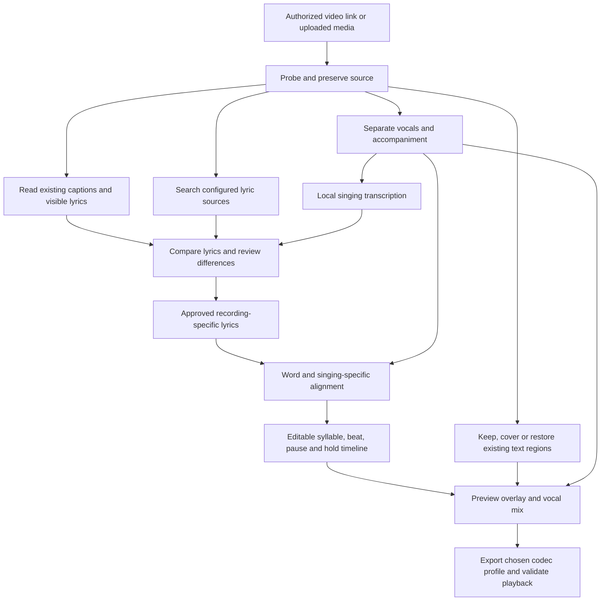

# Architecture decision baseline

Decision date: 2026-11-10. Product requirements are agreed; implementation choices below are proposed defaults to validate after migration.

## Deployment

One Docker Compose project, native Ubuntu host, loopback-only published web port. Docker Engine is the target; do not assume Docker Desktop GPU forwarding. Use a local browser UI, a Python API/job coordinator, and isolated processing workers. Proposed UI stack: React/TypeScript. Proposed API: FastAPI. SQLite stores project metadata and a durable job queue; one coordinator claims jobs to avoid concurrent GPU-heavy execution on shared memory. No Redis or distributed cluster is needed initially.

Workers may use separate images/environments for conflicting model dependencies. Logical workers are audio/lyric processing, picture restoration, and rendering. They need not all run concurrently. Use versioned task payloads and files rather than sharing Python environments. Narrow worker permissions; do not expose internal worker endpoints or mount the Docker socket into the web application. Launch workers through Compose, not through user-supplied commands.

GPU worker images use a pinned gfx1151-compatible ROCm/PyTorch combination where validated. Vulkan is an alternative for compatible engines such as whisper.cpp. CPU processing with the same model is allowed. NPU execution is not required. Host kernel/driver access and container GPU libraries are distinct dependencies. Pass only required GPU device nodes and groups; do not default to privileged containers.

## Processing flow

## Project state

Each project records source hash/metadata, rights/source notes, lyric candidates with provenance, transcriptions, approved text, alignment revisions, text-region masks, audio mix, overlay layout, render profile, model/settings manifest, jobs, and exports. Store timing in integer microseconds against the source timeline. Store display text separately from pronunciation/syllable units. Repeated sections retain distinct timeline instances; never assume the published lyric order matches the recording.

Use immutable intermediate artifacts and explicit revisions for edits. Editing lyrics invalidates affected alignment/render artifacts; changing placement does not require retranscription. Checkpoint completed stages. Interrupted jobs resume from valid artifacts rather than claiming an unfinished stage completed. Allow one-click cancellation between safe processing units.

## Lyrics and cadence editor

Show source candidates and transcription differences, audio waveform, replayable selections, adjustable segment boundaries, and video preview. Distinguish agreement from calibrated confidence. All automatic words and timing remain editable. Never silently add a missing verse based on a lyric source. Handle overlapping singers with optional separate lyric lanes and a user choice of principal line; automatic multi-singer recovery is experimental.

Default overlay is bottom-centered, readable high-contrast text inside safe margins. Support movement, resizing, line wrapping, optional cover panel, and disabling. Entry cues, word/syllable highlighting, bouncing indicator, beat marks, pauses, and hold indicators are individually selectable. Preview and export must share the same timing/layout specification. Use a simple ASS/libass prototype for supported effects; evaluate a dedicated frame renderer for advanced cues. SRT alone cannot represent the full design.

## Existing text

First distinguish a removable subtitle track from text burned into video pixels. OCR suggests text and regions; user confirms what is a lyric. Track masks through changes in position and scene cuts. Preserve unrelated text. Inpainting must be evaluated for flicker, scene changes, moving backgrounds, and foreground subjects. It estimates missing pixels; it does not recover hidden original imagery. Always keep the original source and a cover-panel alternative.

## Storage and portability

Mount separate directories for projects/media, model cache, temporary work, and exports. Store relative project paths. Backups include database plus referenced artifacts with a manifest. Models are identified by revisions/hashes and can be copied or downloaded again subject to license. Credentials use local secret files/environment outside Git.

Later server transfer means moving/rebuilding images, Compose configuration, persistent data, and permitted model files, then revalidating GPU/runtime compatibility. Copying a container alone does not transfer state or host drivers. LAN/remote access and authentication are later work; initial web binding is 127.0.0.1. Local UI should still validate origins and requests; loopback does not justify arbitrary URL fetches, file paths, or shell input.

## Export

Proposed broad-compatibility preset: MP4, H.264, AAC, yuv420p, source frame rate, selectable resolution. Preserve source resolution by default when the selected encoder supports it; report required conversions. Offer advanced profiles after verifying encoder availability and actual players; possible HEVC/AV1 and an archival master are not first-release promises. Preserve source color metadata where supported, and explicitly handle HDR rather than silently misrender it. Retain lossless intermediate audio and avoid repeated lossy encoding. Check duration, audio/video synchronization, decoder errors, and representative playback. Export project timing JSON plus ASS/LRC where representable; richer timing remains in the native project.
